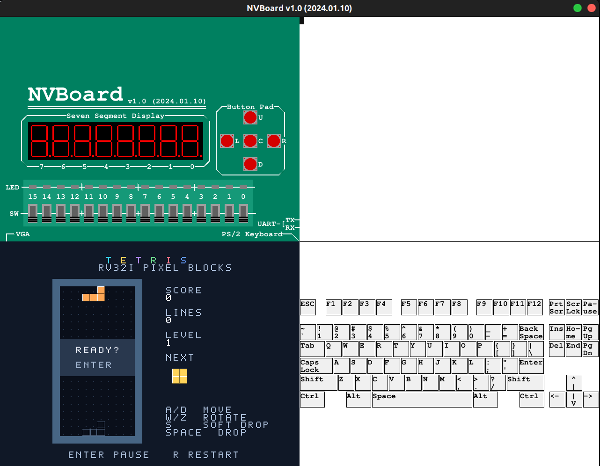
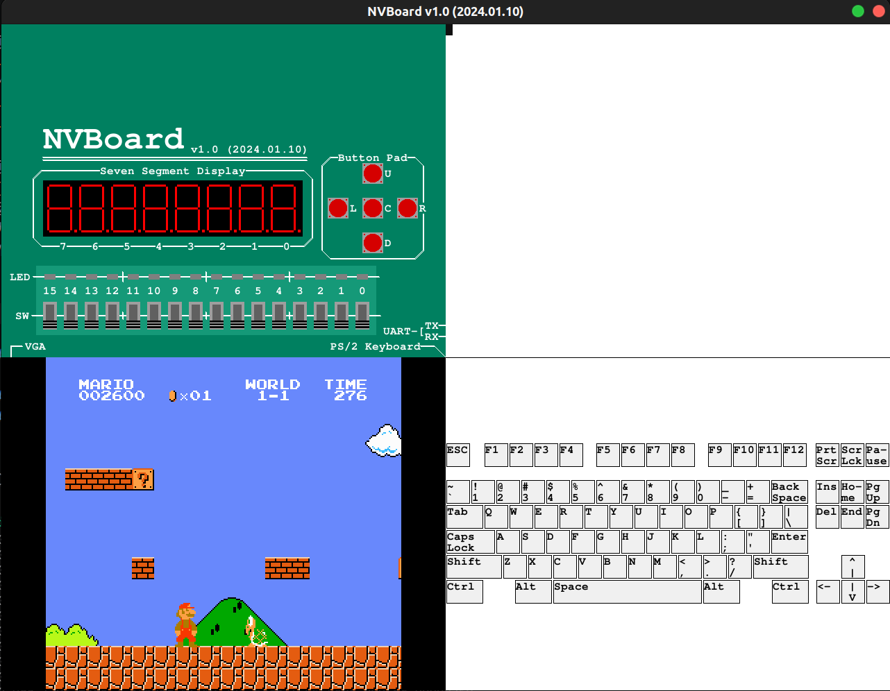
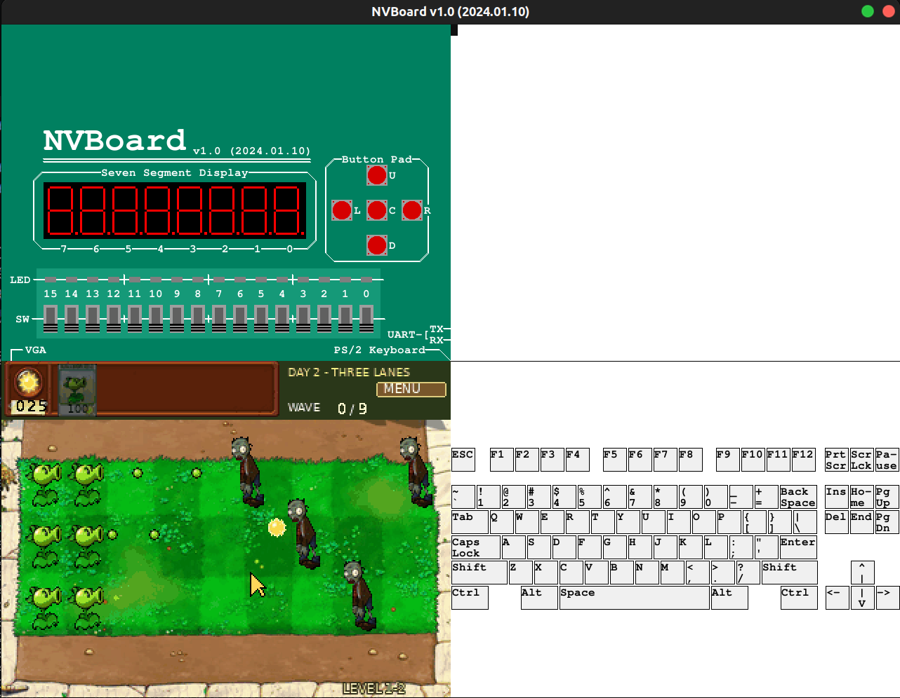

# RV32I_CPU Project 概述

> by 赵楼晗 3240104430

## 功能概述

本项目使用 Verilog 实现简易 RV32I CPU，并通过 Verilator 与 [NVBoard](https://github.com/NJU-ProjectN/nvboard) 完成仿真验证。

项目的片上系统 SoC 包含：

- 32 位单周期 CPU Core，无 Cache、无流水线，运行裸机程序
- 4 MiB ROM 与 4 MiB RAM
- PS/2 键盘、仿真鼠标输入与 VGA 显示，支持鼠标光标

项目以俄罗斯方块（Tetris）、超级马里奥（Super Mario Bros.）和精简植物大战僵尸（PvZ）作为演示。游戏逻辑由 RV32I CPU 执行，画面由 RTL 图形外设生成；NVBoard 提供虚拟板卡与交互界面，尚未进行实际 FPGA 上板验证。

三款游戏的运行截图如下：







俄罗斯方块为本项目自行实现，其余游戏的参考来源：

- Mario：移植自 [SuperMarioBros-C](https://github.com/MitchellSternke/SuperMarioBros-C)，图形从本地 litenes 的 CHR 数据导入，见[移植说明](docs/mario.md)。
- PvZ：参考开源项目 [PvZ-Portable](https://github.com/wszqkzqk/PvZ-Portable)，使用 [PvZ_Assets](https://github.com/FregD156/PvZ_Assets) 中的部分素材，重写为整数逻辑的[双关精简版](sw/PvZ-simplized/README.md)，并非完整原引擎移植。


## 文件架构

主要目录如下：

```text
rv32i_cpu/
├── Makefile
├── rtl/        # RV32I CPU的Verilog描述代码
│   ├── nvboard_top.v             # 板级顶层
│   └── soc/
│       ├── soc_top.v             # 系统顶层
│       ├── core/
│       │   ├── rv32i_core.v
│       │   ├── rv32i_defs.vh
│       │   ├── pc.v
│       │   ├── opcode_decoder.v
│       │   ├── gpr.v
│       │   ├── imm_gen.v
│       │   ├── alu.v
│       │   ├── branch_comp.v
│       │   └── load_store_unit.v
│       ├── memory/
│       │   ├── imem.v  #4MiB ROM指令存储器
│       │   └── dmem.v  #4MiB RAM数据存储器
│       └── periph/
│           ├── ps2_keyboard.v
│           ├── mouse_mmio.v
│           └── vga/
│               ├── vga_timing.v
│               ├── mario_video.v
│               ├── pvz_video.v
│               ├── tile_video.v
│               └── mouse_cursor.v
├── sim/                          # 仿真驱动与测试
│   ├── core_test.cpp
│   ├── compare.py
│   ├── nvboard_main.cpp
│   ├── pvz_main.cpp
│   ├── tetris_main.cpp
│   ├── nemu/
│   ├── unit/
│   └── system/soc_tb.sv
├── sw/                   # 运行的软件程序
│   ├── start.S
│   ├── link.ld
│   ├── tests/                    # 裸机 C 程序
│   ├── mario/                    # 超级马里奥
│   ├── PvZ-simplized/            # 简化版PvZ
│   └── tetris/                   # 俄罗斯方块
├── constr/nvboard_top.nxdc       # 引脚约束配置文件
├── docs/
├── assets/                       
└── build/                        # 构建与测试产物
```

## 运行仿真

### 环境依赖

Ubuntu 上需要 C/C++ 编译器、Verilator、Icarus Verilog、RISC-V GNU 工具链、Python/Pillow 和 SDL2：

```bash
sudo apt install build-essential verilator iverilog \
  gcc-riscv64-linux-gnu g++-riscv64-linux-gnu binutils-riscv64-linux-gnu \
  python3 python3-pil libsdl2-dev libsdl2-image-dev libsdl2-ttf-dev
```

另外本地需有已构建的 NVBoard（详见[NVBoard github仓库](https://github.com/NJU-ProjectN/nvboard)中的说明），在本项目中用 `NVBOARD_HOME` 指定路径；运行 NEMU 对照时，用 `NEMU_SRC` 指定原始源码路径。二者均可作为 `make` 参数覆盖本机默认值。

### 裸机运行简易 C/C++ 程序

示例C源码均位于 `sw/tests/`下，在项目中通过`PROGRAM`参数选择运行：

```bash
cd rv32i_cpu

make c-test PROGRAM=sum         # 仅在RV32I CPU中运行程序
make compare PROGRAM=sum       # 同时在自己电脑与RV32I CPU中运行程序，并进行对比
```

测试结束后终端打印寄存器，返回值为 `RESULT a1/x11`。示例测试程序如下：

| `PROGRAM` | 测试内容 | 预期返回值 |
| --- | --- | --- |
| `smoke` | 检查启动初始化、函数调用及字节/半字访存 | `0`（通过） |
| `sum` | 计算 1+2+…+10 | `55` |
| `fibonacci` | 计算第 12 项 Fibonacci 数 | `144` |
| `gcd` | 计算 48 与 18 的最大公约数 | `6` |
| `sort` | 数组升序排序并校验，返回最大值 | `12` |
| `memory` | 检查跨 64 KiB ROM 读取及 RAM 高地址读写 | `42`（通过） |

### 运行三款游戏
**运行俄罗斯方块：**
```bash
make nvboard PROGRAM=tetris
```
**运行超级马里奥：**
```bash
make nvboard PROGRAM=mario 
```
**运行植物大战僵尸：**
```bash
make nvboard PROGRAM=pvz
```

操作说明：[俄罗斯方块](sw/tetris/README.md)、[Mario](docs/mario.md)、[PvZ](sw/PvZ-simplized/README.md)。

### 其他指令

```bash
make lint                      # CPU RTL 检查
make mario-native              # 电脑上本地运行超级马里奥
make clean                     # 清理构建产物
```

## CPU RTL 设计简述

采用单周期数据通路：取指、译码、执行、访存和写回由组合逻辑连接，PC 与 GPR 在时钟上升沿更新。SoC 可通过 `clock_enable` 暂停核心，等待图形提交完成。

- `pc`、`opcode_decoder`、`imm_gen`：维护指令地址、生成控制信号与立即数。
- `gpr`、`alu`、`branch_comp`：寄存器读写、算术逻辑运算与分支判断。
- `load_store_unit`：字节/半字/字访存、符号扩展、写掩码及对齐检查。

覆盖 RV32I 的 40 条基础指令；`FENCE` 按 NOP 处理，`ECALL/EBREAK` 用于停机。非法指令和未对齐访问会停机，不实现 CSR、特权态和异常处理入口。数据通路及接口详见[架构说明](docs/architecture.md)。


